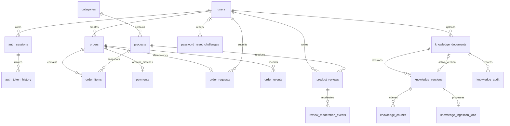

# Thiết kế database TuCoffee

## Phạm vi và trạng thái

Bản thiết kế thống nhất cho 27 chức năng Customer/Admin cùng POS. Nhánh `feat/database-schema` tạo từ `origin/develop` tại `dc18383`. V1–V3 đã tồn tại và giữ nguyên; V4–V7 bổ sung toàn bộ schema tương lai. Có **21 bảng nghiệp vụ**, thêm `flyway_schema_history` là 22 bảng. Việc có bảng chưa có nghĩa API/UI của các phase sau đã hoàn thành.

Chỉ tạo bảng/ràng buộc/index và tài liệu; không tự nhập 18 sản phẩm hoặc chạy migration lên database phát triển trong lượt này. Giỏ hàng và lịch sử chat tạm nằm trong trình duyệt theo phạm vi đã chốt. Không tạo Rewards/voucher/tồn kho/đa chi nhánh/CMS.

MySQL native 8.0.46, InnoDB, database utf8mb4/utf8mb4_0900_ai_ci. JSON_SCHEMA_VALID yêu cầu MySQL >=8.0.17; dự án tiếp tục dùng 8.0.46. Spring/Flyway quản lý migration, Hibernate chỉ validate. Thời gian lưu UTC qua JDBC `connectionTimeZone=UTC`; báo cáo chuyển khoảng ngày Asia/Ho_Chi_Minh thành [start,end). Tiền dùng BIGINT VND nguyên, tối đa 100 triệu/đơn. Không dùng FLOAT/DOUBLE cho tiền.

## Migration

| Phiên bản | Nội dung | Tác động |
|---|---|---|
| V1 | Baseline | Giữ nguyên |
| V2 | Users, sessions, token history, rate limits, identity lock | Giữ nguyên |
| V3 | Google identity | Giữ nguyên; password_hash nullable, google_subject unique |
| V4 | Categories, products | Thêm catalog và khóa ánh xạ dữ liệu nguồn |
| V5 | Orders, items, requests, payments, events | Online/POS chung, snapshot và idempotency |
| V6 | Reviews, moderation audit, reset challenges/limits | Đánh giá sau mua và khôi phục mật khẩu |
| V7 | Knowledge documents/versions/chunks/jobs/audit | Tri thức RAG và index có phiên bản |

Nguồn DDL chính thức: [thư mục Flyway](../backend/src/main/resources/db/migration). Không tạo thêm bảng bằng Hibernate `update/create`, không sửa checksum V1–V3. Các phase tính năng sử dụng schema đã có; nếu cần thay đổi sẽ tạo V8 trở đi, không tạo lại V4–V7.

## ERD tổng quan



ERD hiển thị nhóm quan hệ chính. Các FK actor/confirmed_by/created_by, composite FK và index đầy đủ nằm trong từng bảng bên dưới. Các bảng rate limit/identity_lock độc lập theo khóa kỹ thuật.

## Quy tắc dữ liệu và trách nhiệm

### Catalog và nhập nguồn cũ

`products.category_id` bắt buộc. Món chỉ bán khi product/category đều active; predicate này kiểm tra ở service/query, không thể biểu diễn bằng CHECK liên bảng. Slug danh mục unique, ASCII phân biệt hoa/thường; service chuẩn hóa lowercase. Product có source_system/source_id cùng NULL hoặc cùng có giá trị, unique cả cặp. Dữ liệu từ website cũ dùng source_system cố định và id gốc làm source_id; id local do MySQL sinh, không ghi đè ID hiện có. Nhập lại kiểm tra khóa nguồn, không tự ghi đè sửa đổi admin.

Ảnh lưu filesystem/object storage, DB giữ đường dẫn tương đối; source URLs trong CSV không tự trở thành đường dẫn tin cậy. Upload, dọn ảnh orphan và tải ảnh nguồn thuộc phase catalog. Không copy rating tổng từ nguồn thành review: review chỉ do người mua hợp lệ tạo.

### Orders/POS/payments

Online có buyer và created_by=buyer, operator=NULL; POS bắt buộc operator và created_by=operator, buyer có thể NULL. Vai trò ADMIN, ownership caller và trạng thái tài khoản luôn kiểm tra ở backend; FK không kiểm tra quyền.

`order_items` lưu snapshot tên/giá; subtotal generated từ giá snapshot × quantity. Đổi giá/tên sản phẩm không sửa đơn cũ. Tổng order phải bằng tổng items và tối đa 50 dòng: transaction/service phải kiểm tra vì CHECK không đọc bảng khác. Payload expectedPriceVnd chỉ để đối chiếu, không phải nguồn giá.

`order_requests` unique creator/idempotency_key và order_id; FK ghép đảm bảo đơn thuộc đúng creator, kể cả POS. Ghi order/items/payment/request cùng transaction. Không tạo request mồ côi trước rồi để order_id NULL; xử lý unique conflict bằng tải lại record đã commit và kiểm tra request_hash. UUID cho key, SHA-256 cho canonical request hash; không lưu raw payload nhạy cảm.

Payment có một record/order, FK ghép (order_id,amount_vnd) đối chiếu total_vnd. QR lưu snapshot bank_code/bank_account/bank_account_name/transfer_content; khi thay env, đơn cũ không đổi hướng dẫn. UNPAID không có bằng chứng xác nhận; PAID phải có actor/time/confirmation_key. CASH không nhận bank reference; QR PAID phải có reference. Unique confirmation_key và bank_code/reference chặn dùng một giao dịch cho hai đơn. Service trim/uppercase/bỏ khoảng trắng reference và kiểm tra bank/account/reference không rỗng, không nhận các field confirmed_by/paid do khách gửi.

Luồng PENDING→CONFIRMED→COMPLETED; hủy PENDING/CONFIRMED khi UNPAID theo quyền. COMPLETED cần PAID, không hủy đơn PAID và không đảo PAID→UNPAID. CHECK bảo đảm giá trị trạng thái, terminal timestamps; **chuyển trạng thái, liên hệ với payment và tranh chấp hủy/xác nhận tiền do transaction service bảo đảm**, không có trigger giả định đã triển khai nghiệp vụ. Tất cả cập nhật tăng version và append order_events trong cùng transaction. Doanh thu chỉ COMPLETED+PAID; lọc theo created_at theo kế hoạch, không tự đổi sang ngày confirmed_at/completed_at nếu chưa chốt metric mới.

### Review và reset

Review unique user/product, sao1–5; eligibility từ đơn COMPLETED tại service. Chỉ review is_visible=1 tính list/average/count. Admin ẩn/khôi phục có lý do, actor, thời gian và version trong audit; không sửa nội dung/sao. Khách sửa review ẩn không tự bật lại. Quyền và ghi audit atomic thuộc service.

OTP reset dùng challenge opaque; user_id nullable cho response chung email không tồn tại, delivery SUPPRESSED. code_hash là HMAC-SHA256 có pepper backend, gắn purpose/challenge; không lưu OTP/email/IP plaintext trong rate key. TTL mặc định10phút, 5 lần thử, resend60s và 5 lượt/giờ/email/IP. DB check attempts 0..5 và expires>created; service kiểm tra TTL với clock server, hạn 10phút, purpose và reserve rate counter atomic. Consume/invalidate mutually exclusive, consume+đổi hash+revoke phiên cùng transaction. Gửi lại vô hiệu challenge trước dưới khóa user/identity; không thêm unique user_id vì cần giữ lịch sử nhiều challenge. SMTP không tham gia transaction DB; gửi nền sau commit với trạng thái quan sát được. Schema chưa triển khai worker gửi email/cleanup.

### RAG và index

Document bắt đầu disabled, active_version=NULL. Tạo version/upload → job → PROCESSING → chunks/embedding → READY → publish trong transaction. Composite FK bảo đảm active version thuộc document. FK chunk gồm dimensions nên vector phải cùng kích thước phiên bản; JSON là mảng số có độ dài đúng dimensions. Metadata model/dimensions phải được chốt trước ghi chunks. Trạng thái READY cần indexed_at/model; kiểm tra đủ chunks và chất lượng nội dung thuộc service.

Re-index hoặc đổi model tạo **revision mới** (cùng checksum vẫn được phép), không xóa/ghi đè chunks của active version. Chỉ đổi active_version sau READY; thất bại giữ revision đang phục vụ. Retriever chỉ lấy document enabled, chưa deleted, active version READY; kiểm tra lại nguồn trước phát hành câu trả lời khi đang có request. Không có FK nào tự enforce READY giữa hai bảng; publish phải lock/version và kiểm tra trong service.

Ingestion job unique version; attempts/max_attempts giới hạn, PROCESSING có worker_id/lease_expires_at. Claim job dùng row lock hoặc update có điều kiện; khi hết lease phải fence worker cũ theo attempts/worker_id để không ghi kết quả muộn. Retry cùng job phải reset state/lease đúng; explicit re-index tạo revision/job mới. Các giới hạn50documents/2000chunks, token budget và API quotas là cấu hình service, không CHECK đếm row.

Tài liệu xóa bằng disabled+deleted_at, giữ audit. Muốn purge vật lý phải có quy trình retention riêng: bỏ active pointer trước, xử lý jobs/chunks/audit đúng thứ tự. Không cascade xóa nguồn/audit ngầm. Nội dung tài liệu chỉ được phép công khai; path không trỏ file trực tiếp ra public uploads. Không lưu hội thoại/khóa AI trong schema.

### Lifecycle chung

FK mặc định RESTRICT/NO ACTION, không cascade xóa users/products/orders/payments hoặc audit. Khóa user thay hard delete; category/product ngừng hoạt động; tài liệu soft delete. updated_at có DEFAULT lúc tạo, **service/entity phải cập nhật mỗi lần ghi**; không có ON UPDATE ngầm. Version không tự tăng; service phải tăng và dùng optimistic lock.

Các cột boolean mới có CHECK 0/1; các cột mã `status`, `source`, `method`, `purpose`, `event_type`, `delivery_status`, `action`, `content_type` dùng ASCII binary để từ chối giá trị khác hoa/thường. Riêng snapshot `order_events.from_status/to_status` kế thừa collation database; service chuẩn hóa chữ hoa trước khi ghi audit. Các tên/mô tả dùng charset database để tìm tiếng Việt; q cần escape LIKE, sort allowlist, page/size có giới hạn. Cleanup token/reset/jobs cũ cần chính sách retention và lịch chạy ở phase nghiệp vụ, không tự xóa trong migration.

## Từ điển dữ liệu và ràng buộc

Cột và khai báo dưới đây phản ánh DDL; `NULL` là tùy chọn, `NOT NULL` là bắt buộc. FK/unique/index/CHECK nằm ngay dưới từng bảng. Với users, V3 cho phép password_hash NULL và thêm google_subject; không đổi bản V2 lịch sử.

### `users`

Tài khoản USER/ADMIN, hồ sơ và Google subject. Migration: `V2__identity.sql`.

| Cột | Kiểu, nullable và mặc định |
|---|---|
| `id` | `BIGINT NOT NULL AUTO_INCREMENT PRIMARY KEY` |
| `name` | `VARCHAR(100) NOT NULL` |
| `email` | `VARCHAR(150) NOT NULL` |
| `password_hash` | `VARCHAR(100) NULL — V3 cho phép tài khoản Google-only` |
| `phone` | `VARCHAR(20) NULL` |
| `address` | `VARCHAR(300) NULL` |
| `role` | `VARCHAR(10) NOT NULL DEFAULT 'USER'` |
| `active` | `BOOLEAN NOT NULL DEFAULT TRUE` |
| `created_at` | `TIMESTAMP(6) NOT NULL` |
| `google_subject` | `VARCHAR(255) ASCII ascii_bin NULL UNIQUE` — thêm ở V3 |

Ràng buộc/index:

```sql
CONSTRAINT uk_users_email UNIQUE (email)
CONSTRAINT ck_users_role CHECK (role IN ('USER', 'ADMIN'))
```

### `auth_sessions`

Phiên refresh có hạn và thu hồi. Migration: `V2__identity.sql`.

| Cột | Kiểu, nullable và mặc định |
|---|---|
| `id` | `CHAR(36) NOT NULL PRIMARY KEY` |
| `user_id` | `BIGINT NOT NULL` |
| `refresh_hash` | `CHAR(64) NOT NULL` |
| `expires_at` | `TIMESTAMP(6) NOT NULL` |
| `revoked_at` | `TIMESTAMP(6) NULL` |
| `created_at` | `TIMESTAMP(6) NOT NULL` |

Ràng buộc/index:

```sql
CONSTRAINT uk_sessions_refresh UNIQUE (refresh_hash)
CONSTRAINT fk_sessions_user FOREIGN KEY (user_id) REFERENCES users(id)
INDEX idx_sessions_user (user_id)
```

### `auth_token_history`

Hash token đã rotate để phát hiện reuse. Migration: `V2__identity.sql`.

| Cột | Kiểu, nullable và mặc định |
|---|---|
| `token_hash` | `CHAR(64) NOT NULL PRIMARY KEY` |
| `session_id` | `CHAR(36) NOT NULL` |
| `expires_at` | `TIMESTAMP(6) NOT NULL` |

Ràng buộc/index:

```sql
CONSTRAINT fk_history_session FOREIGN KEY (session_id) REFERENCES auth_sessions(id)
INDEX idx_history_expiry (expires_at)
```

### `auth_rate_limits`

Counter đăng nhập theo khóa đã hash. Migration: `V2__identity.sql`.

| Cột | Kiểu, nullable và mặc định |
|---|---|
| `rate_key` | `CHAR(64) NOT NULL PRIMARY KEY` |
| `failures` | `INT NOT NULL` |
| `window_start` | `TIMESTAMP(6) NOT NULL` |

### `categories`

Danh mục sản phẩm. Migration: `V4__catalog.sql`.

| Cột | Kiểu, nullable và mặc định |
|---|---|
| `id` | `BIGINT NOT NULL AUTO_INCREMENT PRIMARY KEY` |
| `name` | `VARCHAR(100) NOT NULL` |
| `slug` | `VARCHAR(120) CHARACTER SET ascii COLLATE ascii_bin NOT NULL` |
| `is_active` | `BOOLEAN NOT NULL DEFAULT TRUE` |
| `version` | `BIGINT NOT NULL DEFAULT 0` |
| `created_at` | `TIMESTAMP(6) NOT NULL DEFAULT CURRENT_TIMESTAMP(6)` |
| `updated_at` | `TIMESTAMP(6) NOT NULL DEFAULT CURRENT_TIMESTAMP(6)` |

Ràng buộc/index:

```sql
CONSTRAINT uk_categories_slug UNIQUE(slug)
CONSTRAINT ck_categories_name CHECK(CHAR_LENGTH(TRIM(name)) BETWEEN 1 AND 100)
CONSTRAINT ck_categories_version CHECK(version >= 0)
INDEX idx_categories_active(is_active,id)
CONSTRAINT ck_categories_is_active CHECK(is_active IN (0,1))
```

### `products`

Sản phẩm và ánh xạ nguồn nhập. Migration: `V4__catalog.sql`.

| Cột | Kiểu, nullable và mặc định |
|---|---|
| `id` | `BIGINT NOT NULL AUTO_INCREMENT PRIMARY KEY` |
| `category_id` | `BIGINT NOT NULL` |
| `name` | `VARCHAR(200) NOT NULL` |
| `description` | `TEXT NULL` |
| `price_vnd` | `BIGINT NOT NULL` |
| `image_path` | `VARCHAR(1024) NULL` |
| `is_active` | `BOOLEAN NOT NULL DEFAULT TRUE` |
| `version` | `BIGINT NOT NULL DEFAULT 0` |
| `source_system` | `VARCHAR(100) CHARACTER SET ascii COLLATE ascii_bin NULL` |
| `source_id` | `VARCHAR(100) CHARACTER SET ascii COLLATE ascii_bin NULL` |
| `created_at` | `TIMESTAMP(6) NOT NULL DEFAULT CURRENT_TIMESTAMP(6)` |
| `updated_at` | `TIMESTAMP(6) NOT NULL DEFAULT CURRENT_TIMESTAMP(6)` |

Ràng buộc/index:

```sql
CONSTRAINT fk_products_category FOREIGN KEY(category_id) REFERENCES categories(id)
CONSTRAINT uk_products_source UNIQUE(source_system,source_id)
CONSTRAINT ck_products_price CHECK(price_vnd BETWEEN 0 AND 100000000)
CONSTRAINT ck_products_name CHECK(CHAR_LENGTH(TRIM(name)) BETWEEN 1 AND 200)
CONSTRAINT ck_products_version CHECK(version >= 0)
CONSTRAINT ck_products_source CHECK((source_system IS NULL AND source_id IS NULL) OR (source_system IS NOT NULL AND source_id IS NOT NULL AND CHAR_LENGTH(source_system)>0 AND CHAR_LENGTH(source_id)>0))
INDEX idx_products_catalog(category_id,is_active,id)
INDEX idx_products_active(is_active,id)
CONSTRAINT ck_products_is_active CHECK(is_active IN (0,1))
```

### `orders`

Đơn online/POS, người tạo và snapshot liên hệ. Migration: `V5__orders_and_payments.sql`.

| Cột | Kiểu, nullable và mặc định |
|---|---|
| `id` | `BIGINT NOT NULL AUTO_INCREMENT PRIMARY KEY` |
| `public_code` | `VARCHAR(40) CHARACTER SET ascii COLLATE ascii_bin NOT NULL` |
| `buyer_id` | `BIGINT NULL` |
| `operator_id` | `BIGINT NULL` |
| `created_by` | `BIGINT NOT NULL` |
| `source` | `VARCHAR(10) CHARACTER SET ascii COLLATE ascii_bin NOT NULL` |
| `status` | `VARCHAR(12) CHARACTER SET ascii COLLATE ascii_bin NOT NULL DEFAULT 'PENDING'` |
| `total_vnd` | `BIGINT NOT NULL` |
| `customer_name` | `VARCHAR(100) NOT NULL` |
| `customer_phone` | `VARCHAR(20) NULL` |
| `customer_address` | `VARCHAR(300) NULL` |
| `note` | `VARCHAR(1000) NULL` |
| `version` | `BIGINT NOT NULL DEFAULT 0` |
| `created_at` | `TIMESTAMP(6) NOT NULL DEFAULT CURRENT_TIMESTAMP(6)` |
| `updated_at` | `TIMESTAMP(6) NOT NULL DEFAULT CURRENT_TIMESTAMP(6)` |
| `completed_at` | `TIMESTAMP(6) NULL` |
| `cancelled_at` | `TIMESTAMP(6) NULL` |

Ràng buộc/index:

```sql
CONSTRAINT uk_orders_code UNIQUE(public_code)
CONSTRAINT uk_orders_amount UNIQUE(id,total_vnd)
CONSTRAINT uk_orders_creator UNIQUE(id,created_by)
CONSTRAINT fk_orders_buyer FOREIGN KEY(buyer_id) REFERENCES users(id)
CONSTRAINT fk_orders_operator FOREIGN KEY(operator_id) REFERENCES users(id)
CONSTRAINT fk_orders_creator FOREIGN KEY(created_by) REFERENCES users(id)
CONSTRAINT ck_orders_money CHECK(total_vnd BETWEEN 0 AND 100000000)
CONSTRAINT ck_orders_version CHECK(version >= 0)
CONSTRAINT ck_orders_name CHECK(CHAR_LENGTH(TRIM(customer_name))>0)
CONSTRAINT ck_orders_status CHECK(status IN ('PENDING','CONFIRMED','COMPLETED','CANCELLED'))
CONSTRAINT ck_orders_source CHECK((source='ONLINE' AND buyer_id IS NOT NULL AND created_by=buyer_id AND operator_id IS NULL) OR (source='POS' AND operator_id IS NOT NULL AND created_by=operator_id))
CONSTRAINT ck_orders_terminal CHECK((status='COMPLETED' AND completed_at IS NOT NULL AND cancelled_at IS NULL) OR (status='CANCELLED' AND cancelled_at IS NOT NULL AND completed_at IS NULL) OR (status IN ('PENDING','CONFIRMED') AND completed_at IS NULL AND cancelled_at IS NULL))
INDEX idx_orders_buyer(buyer_id,created_at,id)
INDEX idx_orders_queue(status,created_at,id)
INDEX idx_orders_source(source,created_at,id)
INDEX idx_orders_revenue(status,completed_at,id)
```

### `order_items`

Dòng món với giá/tên snapshot. Migration: `V5__orders_and_payments.sql`.

| Cột | Kiểu, nullable và mặc định |
|---|---|
| `id` | `BIGINT NOT NULL AUTO_INCREMENT PRIMARY KEY` |
| `order_id` | `BIGINT NOT NULL` |
| `product_id` | `BIGINT NOT NULL` |
| `product_name` | `VARCHAR(200) NOT NULL` |
| `unit_price_vnd` | `BIGINT NOT NULL` |
| `quantity` | `INT NOT NULL` |
| `subtotal_vnd` | `BIGINT GENERATED ALWAYS AS (unit_price_vnd * quantity) STORED` |

Ràng buộc/index:

```sql
CONSTRAINT fk_items_order FOREIGN KEY(order_id) REFERENCES orders(id)
CONSTRAINT fk_items_product FOREIGN KEY(product_id) REFERENCES products(id)
CONSTRAINT uk_items_product UNIQUE(order_id,product_id)
CONSTRAINT ck_items_price CHECK(unit_price_vnd BETWEEN 0 AND 100000000)
CONSTRAINT ck_items_quantity CHECK(quantity BETWEEN 1 AND 99)
CONSTRAINT ck_items_name CHECK(CHAR_LENGTH(TRIM(product_name))>0)
```

### `order_requests`

Kết quả đặt đơn theo idempotency key. Migration: `V5__orders_and_payments.sql`.

| Cột | Kiểu, nullable và mặc định |
|---|---|
| `id` | `BIGINT NOT NULL AUTO_INCREMENT PRIMARY KEY` |
| `creator_id` | `BIGINT NOT NULL` |
| `idempotency_key` | `CHAR(36) CHARACTER SET ascii COLLATE ascii_bin NOT NULL` |
| `request_hash` | `CHAR(64) CHARACTER SET ascii COLLATE ascii_bin NOT NULL` |
| `order_id` | `BIGINT NOT NULL` |
| `created_at` | `TIMESTAMP(6) NOT NULL DEFAULT CURRENT_TIMESTAMP(6)` |

Ràng buộc/index:

```sql
CONSTRAINT uk_order_requests_key UNIQUE(creator_id,idempotency_key)
CONSTRAINT uk_order_requests_order UNIQUE(order_id)
CONSTRAINT fk_requests_creator FOREIGN KEY(creator_id) REFERENCES users(id)
CONSTRAINT fk_requests_order FOREIGN KEY(order_id,creator_id) REFERENCES orders(id,created_by)
```

### `payments`

Tiền mặt/QR và bằng chứng xác nhận. Migration: `V5__orders_and_payments.sql`.

| Cột | Kiểu, nullable và mặc định |
|---|---|
| `id` | `BIGINT NOT NULL AUTO_INCREMENT PRIMARY KEY` |
| `order_id` | `BIGINT NOT NULL` |
| `method` | `VARCHAR(16) CHARACTER SET ascii COLLATE ascii_bin NOT NULL` |
| `status` | `VARCHAR(8) CHARACTER SET ascii COLLATE ascii_bin NOT NULL DEFAULT 'UNPAID'` |
| `amount_vnd` | `BIGINT NOT NULL` |
| `bank_code` | `VARCHAR(30) CHARACTER SET ascii COLLATE ascii_bin NULL` |
| `bank_account` | `VARCHAR(50) NULL` |
| `bank_account_name` | `VARCHAR(150) NULL` |
| `transfer_content` | `VARCHAR(100) NULL` |
| `reference` | `VARCHAR(100) CHARACTER SET ascii COLLATE ascii_bin NULL` |
| `confirmation_key` | `VARCHAR(160) CHARACTER SET ascii COLLATE ascii_bin NULL` |
| `confirmed_by` | `BIGINT NULL` |
| `confirmed_at` | `TIMESTAMP(6) NULL` |
| `created_at` | `TIMESTAMP(6) NOT NULL DEFAULT CURRENT_TIMESTAMP(6)` |

Ràng buộc/index:

```sql
CONSTRAINT uk_payments_order UNIQUE(order_id)
CONSTRAINT uk_payments_confirmation UNIQUE(confirmation_key)
CONSTRAINT uk_payments_bank_reference UNIQUE(bank_code,reference)
CONSTRAINT fk_payments_amount FOREIGN KEY(order_id,amount_vnd) REFERENCES orders(id,total_vnd)
CONSTRAINT fk_payments_actor FOREIGN KEY(confirmed_by) REFERENCES users(id)
CONSTRAINT ck_payments_method CHECK(method IN ('CASH','QR_TRANSFER'))
CONSTRAINT ck_payments_money CHECK(amount_vnd BETWEEN 0 AND 100000000)
CONSTRAINT ck_payments_state CHECK((status='UNPAID' AND confirmed_by IS NULL AND confirmed_at IS NULL AND confirmation_key IS NULL AND reference IS NULL) OR (status='PAID' AND confirmed_by IS NOT NULL AND confirmed_at IS NOT NULL AND confirmation_key IS NOT NULL AND CHAR_LENGTH(confirmation_key)>0))
CONSTRAINT ck_payments_bank CHECK((method='CASH' AND bank_code IS NULL AND reference IS NULL AND bank_account IS NULL AND bank_account_name IS NULL AND transfer_content IS NULL) OR (method='QR_TRANSFER' AND bank_code IS NOT NULL AND bank_account IS NOT NULL AND bank_account_name IS NOT NULL AND transfer_content IS NOT NULL AND (status='UNPAID' OR reference IS NOT NULL)))
INDEX idx_payments_status(status,confirmed_at,order_id)
```

### `order_events`

Lịch sử thao tác đơn, chỉ append. Migration: `V5__orders_and_payments.sql`.

| Cột | Kiểu, nullable và mặc định |
|---|---|
| `id` | `BIGINT NOT NULL AUTO_INCREMENT PRIMARY KEY` |
| `order_id` | `BIGINT NOT NULL` |
| `actor_id` | `BIGINT NOT NULL` |
| `event_type` | `VARCHAR(24) CHARACTER SET ascii COLLATE ascii_bin NOT NULL` |
| `from_status` | `VARCHAR(12) NULL` |
| `to_status` | `VARCHAR(12) NOT NULL` |
| `order_version` | `BIGINT NOT NULL` |
| `payment_reference` | `VARCHAR(160) NULL` |
| `note` | `VARCHAR(1000) NULL` |
| `created_at` | `TIMESTAMP(6) NOT NULL DEFAULT CURRENT_TIMESTAMP(6)` |

Ràng buộc/index:

```sql
CONSTRAINT fk_order_events_order FOREIGN KEY(order_id) REFERENCES orders(id)
CONSTRAINT fk_order_events_actor FOREIGN KEY(actor_id) REFERENCES users(id)
CONSTRAINT ck_order_events_type CHECK(event_type IN ('CREATED','STATUS_CHANGED','PAYMENT_CONFIRMED'))
CONSTRAINT ck_order_events_to CHECK(to_status IN ('PENDING','CONFIRMED','COMPLETED','CANCELLED'))
CONSTRAINT ck_order_events_from CHECK(from_status IS NULL OR from_status IN ('PENDING','CONFIRMED','COMPLETED','CANCELLED'))
CONSTRAINT ck_order_events_version CHECK(order_version>=0)
INDEX idx_order_events_history(order_id,created_at,id)
```

### `product_reviews`

Đánh giá sau mua và trạng thái hiển thị. Migration: `V6__reviews_and_password_recovery.sql`.

| Cột | Kiểu, nullable và mặc định |
|---|---|
| `id` | `BIGINT NOT NULL AUTO_INCREMENT PRIMARY KEY` |
| `user_id` | `BIGINT NOT NULL` |
| `product_id` | `BIGINT NOT NULL` |
| `stars` | `INT NOT NULL` |
| `comment` | `VARCHAR(2000) NULL` |
| `is_visible` | `BOOLEAN NOT NULL DEFAULT TRUE` |
| `version` | `BIGINT NOT NULL DEFAULT 0` |
| `created_at` | `TIMESTAMP(6) NOT NULL DEFAULT CURRENT_TIMESTAMP(6)` |
| `updated_at` | `TIMESTAMP(6) NOT NULL DEFAULT CURRENT_TIMESTAMP(6)` |

Ràng buộc/index:

```sql
CONSTRAINT uk_reviews_purchase UNIQUE(user_id,product_id)
CONSTRAINT fk_reviews_user FOREIGN KEY(user_id) REFERENCES users(id)
CONSTRAINT fk_reviews_product FOREIGN KEY(product_id) REFERENCES products(id)
CONSTRAINT ck_reviews_stars CHECK(stars BETWEEN 1 AND 5)
CONSTRAINT ck_reviews_version CHECK(version>=0)
INDEX idx_reviews_public(product_id,is_visible,created_at,id)
INDEX idx_reviews_admin(is_visible,created_at,id)
CONSTRAINT ck_product_reviews_is_visible CHECK(is_visible IN (0,1))
```

### `review_moderation_events`

Lịch sử admin ẩn/khôi phục. Migration: `V6__reviews_and_password_recovery.sql`.

| Cột | Kiểu, nullable và mặc định |
|---|---|
| `id` | `BIGINT NOT NULL AUTO_INCREMENT PRIMARY KEY` |
| `review_id` | `BIGINT NOT NULL` |
| `actor_id` | `BIGINT NOT NULL` |
| `is_visible` | `BOOLEAN NOT NULL` |
| `reason` | `VARCHAR(500) NOT NULL` |
| `review_version` | `BIGINT NOT NULL` |
| `created_at` | `TIMESTAMP(6) NOT NULL DEFAULT CURRENT_TIMESTAMP(6)` |

Ràng buộc/index:

```sql
CONSTRAINT fk_review_audit_review FOREIGN KEY(review_id) REFERENCES product_reviews(id)
CONSTRAINT fk_review_audit_actor FOREIGN KEY(actor_id) REFERENCES users(id)
CONSTRAINT ck_review_audit_reason CHECK(CHAR_LENGTH(TRIM(reason))>0)
CONSTRAINT ck_review_audit_version CHECK(review_version>=0)
INDEX idx_review_audit_history(review_id,created_at,id)
CONSTRAINT ck_review_moderation_events_is_visible CHECK(is_visible IN (0,1))
```

### `password_reset_challenges`

Challenge reset, HMAC OTP và vòng đời. Migration: `V6__reviews_and_password_recovery.sql`.

| Cột | Kiểu, nullable và mặc định |
|---|---|
| `challenge_id` | `CHAR(36) CHARACTER SET ascii COLLATE ascii_bin NOT NULL PRIMARY KEY` |
| `user_id` | `BIGINT NULL` |
| `purpose` | `VARCHAR(20) CHARACTER SET ascii COLLATE ascii_bin NOT NULL DEFAULT 'RESET_PASSWORD'` |
| `code_hash` | `CHAR(64) CHARACTER SET ascii COLLATE ascii_bin NOT NULL` |
| `attempts` | `INT NOT NULL DEFAULT 0` |
| `created_at` | `TIMESTAMP(6) NOT NULL DEFAULT CURRENT_TIMESTAMP(6)` |
| `expires_at` | `TIMESTAMP(6) NOT NULL` |
| `consumed_at` | `TIMESTAMP(6) NULL` |
| `invalidated_at` | `TIMESTAMP(6) NULL` |
| `delivery_status` | `VARCHAR(12) CHARACTER SET ascii COLLATE ascii_bin NOT NULL DEFAULT 'PENDING'` |

Ràng buộc/index:

```sql
CONSTRAINT fk_reset_user FOREIGN KEY(user_id) REFERENCES users(id)
CONSTRAINT ck_reset_purpose CHECK(purpose='RESET_PASSWORD')
CONSTRAINT ck_reset_attempts CHECK(attempts BETWEEN 0 AND 5)
CONSTRAINT ck_reset_expiry CHECK(expires_at>created_at)
CONSTRAINT ck_reset_terminal CHECK(consumed_at IS NULL OR invalidated_at IS NULL)
CONSTRAINT ck_reset_delivery CHECK(delivery_status IN ('PENDING','SENT','FAILED','SUPPRESSED'))
INDEX idx_reset_user(user_id,purpose,created_at)
INDEX idx_reset_expiry(expires_at)
```

### `password_reset_limits`

Rate reservation email/IP, không lưu địa chỉ thô. Migration: `V6__reviews_and_password_recovery.sql`.

| Cột | Kiểu, nullable và mặc định |
|---|---|
| `rate_key` | `CHAR(64) CHARACTER SET ascii COLLATE ascii_bin NOT NULL PRIMARY KEY` |
| `window_start` | `TIMESTAMP(6) NOT NULL` |
| `last_sent_at` | `TIMESTAMP(6) NULL` |
| `request_count` | `INT NOT NULL DEFAULT 0` |
| `version` | `BIGINT NOT NULL DEFAULT 0` |

Ràng buộc/index:

```sql
CONSTRAINT ck_reset_limit_count CHECK(request_count>=0)
CONSTRAINT ck_reset_limit_version CHECK(version>=0)
INDEX idx_reset_limit_cleanup(window_start)
```

### `knowledge_documents`

Tài liệu logic và revision đang phục vụ. Migration: `V7__knowledge_rag.sql`.

| Cột | Kiểu, nullable và mặc định |
|---|---|
| `id` | `BIGINT NOT NULL AUTO_INCREMENT PRIMARY KEY` |
| `title` | `VARCHAR(200) NOT NULL` |
| `enabled` | `BOOLEAN NOT NULL DEFAULT FALSE` |
| `active_version_id` | `BIGINT NULL` |
| `created_by` | `BIGINT NOT NULL` |
| `version` | `BIGINT NOT NULL DEFAULT 0` |
| `created_at` | `TIMESTAMP(6) NOT NULL DEFAULT CURRENT_TIMESTAMP(6)` |
| `updated_at` | `TIMESTAMP(6) NOT NULL DEFAULT CURRENT_TIMESTAMP(6)` |
| `deleted_at` | `TIMESTAMP(6) NULL` |

Ràng buộc/index:

```sql
CONSTRAINT fk_knowledge_author FOREIGN KEY(created_by) REFERENCES users(id)
CONSTRAINT ck_knowledge_title CHECK(CHAR_LENGTH(TRIM(title))>0)
CONSTRAINT ck_knowledge_version CHECK(version>=0)
CONSTRAINT ck_knowledge_enabled CHECK(enabled=FALSE OR (active_version_id IS NOT NULL AND deleted_at IS NULL))
INDEX idx_knowledge_retrieval(enabled,deleted_at,id)
CONSTRAINT ck_knowledge_documents_enabled CHECK(enabled IN (0,1))
```

### `knowledge_versions`

File và metadata của từng revision. Migration: `V7__knowledge_rag.sql`.

| Cột | Kiểu, nullable và mặc định |
|---|---|
| `id` | `BIGINT NOT NULL AUTO_INCREMENT PRIMARY KEY` |
| `document_id` | `BIGINT NOT NULL` |
| `revision` | `INT NOT NULL` |
| `original_filename` | `VARCHAR(255) NOT NULL` |
| `storage_path` | `VARCHAR(1024) NOT NULL` |
| `content_type` | `VARCHAR(40) CHARACTER SET ascii COLLATE ascii_bin NOT NULL` |
| `file_size_bytes` | `BIGINT NOT NULL` |
| `content_hash` | `CHAR(64) CHARACTER SET ascii COLLATE ascii_bin NOT NULL` |
| `status` | `VARCHAR(12) CHARACTER SET ascii COLLATE ascii_bin NOT NULL DEFAULT 'UPLOADED'` |
| `embedding_model` | `VARCHAR(150) NULL` |
| `embedding_dimensions` | `INT NULL` |
| `error_code` | `VARCHAR(80) NULL` |
| `created_by` | `BIGINT NOT NULL` |
| `created_at` | `TIMESTAMP(6) NOT NULL DEFAULT CURRENT_TIMESTAMP(6)` |
| `indexed_at` | `TIMESTAMP(6) NULL` |

Ràng buộc/index:

```sql
CONSTRAINT uk_knowledge_revision UNIQUE(document_id,revision)
CONSTRAINT uk_knowledge_owned_version UNIQUE(document_id,id)
CONSTRAINT uk_knowledge_vector_version UNIQUE(document_id,id,embedding_dimensions)
CONSTRAINT fk_knowledge_version_document FOREIGN KEY(document_id) REFERENCES knowledge_documents(id)
CONSTRAINT fk_knowledge_version_author FOREIGN KEY(created_by) REFERENCES users(id)
CONSTRAINT ck_knowledge_revision CHECK(revision>0)
CONSTRAINT ck_knowledge_file_size CHECK(file_size_bytes BETWEEN 1 AND 10485760)
CONSTRAINT ck_knowledge_type CHECK(content_type IN ('text/plain','text/markdown','application/pdf'))
CONSTRAINT ck_knowledge_status CHECK(status IN ('UPLOADED','PROCESSING','READY','FAILED'))
CONSTRAINT ck_knowledge_embedding CHECK((embedding_model IS NULL AND embedding_dimensions IS NULL) OR (embedding_model IS NOT NULL AND CHAR_LENGTH(TRIM(embedding_model))>0 AND embedding_dimensions IS NOT NULL AND embedding_dimensions BETWEEN 1 AND 4096))
CONSTRAINT ck_knowledge_ready CHECK(status<>'READY' OR (indexed_at IS NOT NULL AND embedding_model IS NOT NULL))
INDEX idx_knowledge_versions_status(status,created_at,id)
```

### `knowledge_chunks`

Đoạn tri thức và vector số. Migration: `V7__knowledge_rag.sql`.

| Cột | Kiểu, nullable và mặc định |
|---|---|
| `id` | `BIGINT NOT NULL AUTO_INCREMENT PRIMARY KEY` |
| `document_id` | `BIGINT NOT NULL` |
| `version_id` | `BIGINT NOT NULL` |
| `ordinal` | `INT NOT NULL` |
| `content` | `MEDIUMTEXT NOT NULL` |
| `page_number` | `INT NULL` |
| `section_title` | `VARCHAR(300) NULL` |
| `token_count` | `INT NOT NULL` |
| `embedding` | `JSON NOT NULL` |
| `embedding_dimensions` | `INT NOT NULL` |
| `created_at` | `TIMESTAMP(6) NOT NULL DEFAULT CURRENT_TIMESTAMP(6)` |

Ràng buộc/index:

```sql
CONSTRAINT uk_knowledge_chunk UNIQUE(version_id,ordinal)
CONSTRAINT fk_chunks_owned_version FOREIGN KEY(document_id,version_id,embedding_dimensions) REFERENCES knowledge_versions(document_id,id,embedding_dimensions)
CONSTRAINT ck_chunks_ordinal CHECK(ordinal>=0)
CONSTRAINT ck_chunks_page CHECK(page_number IS NULL OR page_number>0)
CONSTRAINT ck_chunks_tokens CHECK(token_count>0)
CONSTRAINT ck_chunks_content CHECK(CHAR_LENGTH(TRIM(content))>0)
CONSTRAINT ck_chunks_embedding CHECK(embedding_dimensions BETWEEN 1 AND 4096 AND JSON_TYPE(embedding)='ARRAY' AND JSON_LENGTH(embedding)=embedding_dimensions AND JSON_SCHEMA_VALID('{"type":"array","items":{"type":"number"}}',embedding))
```

### `knowledge_ingestion_jobs`

Queue index/retry/lease bền vững. Migration: `V7__knowledge_rag.sql`.

| Cột | Kiểu, nullable và mặc định |
|---|---|
| `id` | `BIGINT NOT NULL AUTO_INCREMENT PRIMARY KEY` |
| `version_id` | `BIGINT NOT NULL` |
| `status` | `VARCHAR(12) CHARACTER SET ascii COLLATE ascii_bin NOT NULL DEFAULT 'PENDING'` |
| `attempts` | `INT NOT NULL DEFAULT 0` |
| `max_attempts` | `INT NOT NULL DEFAULT 3` |
| `worker_id` | `VARCHAR(100) NULL` |
| `lease_expires_at` | `TIMESTAMP(6) NULL` |
| `next_attempt_at` | `TIMESTAMP(6) NOT NULL DEFAULT CURRENT_TIMESTAMP(6)` |
| `error_code` | `VARCHAR(80) NULL` |
| `created_at` | `TIMESTAMP(6) NOT NULL DEFAULT CURRENT_TIMESTAMP(6)` |
| `updated_at` | `TIMESTAMP(6) NOT NULL DEFAULT CURRENT_TIMESTAMP(6)` |

Ràng buộc/index:

```sql
CONSTRAINT uk_ingestion_version UNIQUE(version_id)
CONSTRAINT fk_ingestion_version FOREIGN KEY(version_id) REFERENCES knowledge_versions(id)
CONSTRAINT ck_ingestion_status CHECK(status IN ('PENDING','PROCESSING','SUCCEEDED','FAILED'))
CONSTRAINT ck_ingestion_attempts CHECK(max_attempts BETWEEN 1 AND 10 AND attempts BETWEEN 0 AND max_attempts)
CONSTRAINT ck_ingestion_lease CHECK((status='PROCESSING' AND worker_id IS NOT NULL AND lease_expires_at IS NOT NULL) OR (status<>'PROCESSING' AND worker_id IS NULL AND lease_expires_at IS NULL))
INDEX idx_ingestion_queue(status,next_attempt_at,id)
INDEX idx_ingestion_lease(status,lease_expires_at)
```

### `knowledge_audit`

Lịch sử quản trị tài liệu. Migration: `V7__knowledge_rag.sql`.

| Cột | Kiểu, nullable và mặc định |
|---|---|
| `id` | `BIGINT NOT NULL AUTO_INCREMENT PRIMARY KEY` |
| `document_id` | `BIGINT NOT NULL` |
| `version_id` | `BIGINT NULL` |
| `actor_id` | `BIGINT NOT NULL` |
| `action` | `VARCHAR(20) CHARACTER SET ascii COLLATE ascii_bin NOT NULL` |
| `note` | `VARCHAR(500) NULL` |
| `created_at` | `TIMESTAMP(6) NOT NULL DEFAULT CURRENT_TIMESTAMP(6)` |

Ràng buộc/index:

```sql
CONSTRAINT fk_knowledge_audit_document FOREIGN KEY(document_id) REFERENCES knowledge_documents(id)
CONSTRAINT fk_knowledge_audit_version FOREIGN KEY(document_id,version_id) REFERENCES knowledge_versions(document_id,id)
CONSTRAINT fk_knowledge_audit_actor FOREIGN KEY(actor_id) REFERENCES users(id)
CONSTRAINT ck_knowledge_audit_action CHECK(action IN ('UPLOAD','REPLACE','REINDEX','ENABLE','DISABLE','DELETE'))
INDEX idx_knowledge_audit_history(document_id,created_at,id)
```

## Thực hiện migration và kiểm tra

Trước khi chạy trên dữ liệu thật: backup database, xác nhận host/schema và quyền, đóng băng thao tác ghi khi cần; Flyway validate checksum rồi migrate. MySQL DDL auto-commit: lỗi ở giữa có thể để lại bảng đã tạo. Không tự chạy repair/drop hoặc sửa migration đã chạy; kiểm tra failure/version, phục hồi backup hoặc dọn chính xác đối tượng của migration chưa thành công theo runbook được duyệt. Rollback app không xóa bảng mới; quay về binary tương thích hoặc roll forward.

Chạy backend từ checkout này sẽ tự migrate DB cấu hình bởi env; lượt phát triển schema chỉ chạy test trên instance riêng, chưa áp dụng vào `tu_coffee` trên cổng3306. V4–V7 không ghi dữ liệu mẫu, không tạo ADMIN, không đổi sessions/account.

Kiểm thử dùng `TEST_MYSQL_HOST`, `TEST_MYSQL_PORT`, `TEST_MYSQL_USER`, `TEST_MYSQL_PASSWORD` của môi trường riêng. Tài khoản test cần CREATE/DROP các schema tên `tu_coffee_test_*`; không dùng credential ứng dụng hoặc DB development. `DatabaseSchemaMigrationTests` tự tạo schema khác cho mỗi case, dọn đúng schema đó sau test; không chia fixture với IdentityHttpTests.

```powershell
# Tại backend/, sau khi đã đặt TEST_MYSQL_* cho MySQL test riêng:
.\mvnw.cmd -Dtest=DatabaseSchemaMigrationTests test
.\mvnw.cmd verify
```

Kiểm tra bao gồm migrate rỗng đếnV7, migrate lại không thay đổi, upgrade V3 giữ tài khoản/phiên/checksum, FK ownership POS/online, tiền payment, giá snapshot, unique ngân hàng/review, OTP lifecycle, RAG revision/dimensions/JSON/lease. Hibernate validate được kiểm tra cùng bộ test backend đầy đủ. Không kiểm chứng API/UI catalog/order/recovery/RAG vì chưa triển khai các phase đó.

Nguồn kỹ thuật: [MySQL JSON schema validation](https://dev.mysql.com/doc/refman/8.0/en/json-validation-functions.html). Phạm vi tính năng theo kế hoạch dự án ngày02/11/2026, được hợp nhất ở tài liệu này cho thiết kế dữ liệu; không phụ thuộc vào thư mục plans bị ignore để tra schema.

Kết quả chạy thực tế: [báo cáo kiểm chứng](reports/2026-11-03-database-schema-verification.md).
